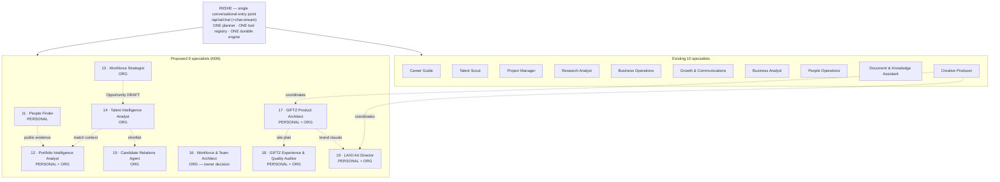
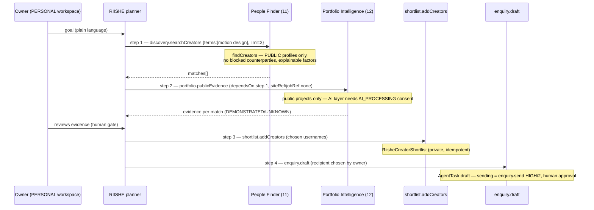
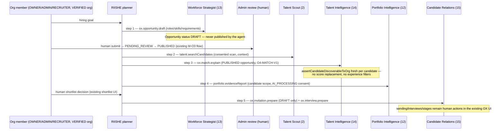
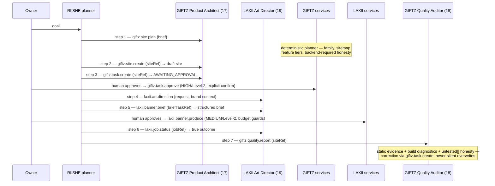
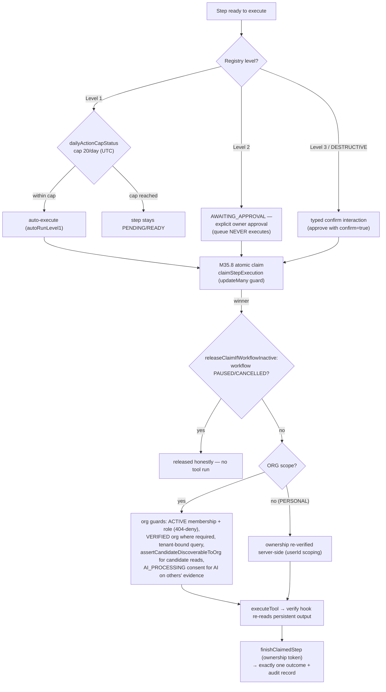

# M36 — Multi-Agent Workforce Intelligence: Architecture & Integration Specification

**Milestone:** M36.0 — read-only source audit + architecture specification. Architecture-only: no TypeScript,
Prisma, UI, API, schema, deployment or provisioning changes were made by this milestone.
**Status:** COMPLETE (this document is the architecture of record for the M36 series).
**Baseline:** verified starting/ending SHA `98216902b8d5e8433782051f1612de80cdae87b8` (PR #14 merge, M35.8) —
read-only audit; the tree was not modified. Branch `main`, publication via `scripts/ops/bean-sync.sh`
(fast-forward only), review PR opened for the owner — never self-merged.
**Regulatory context:** `AGENTS.md`, `DEVELOPMENT_SAFETY.md`, `docs/ops/MILESTONE_EXECUTION_PROTOCOL.md`
(§3 approval gates) are binding. Every schema change, security-sensitive behavior change or API contract
change named in this document requires explicit owner approval BEFORE implementation (Protocol §3).

> **M36.1 implementation addendum (2026-11-26).** The first implementation milestone is COMPLETE for the
> PERSONAL scope: specialists `people-finder` (§3-11) and `portfolio-intelligence` (§3-12) are registered
> over real tools; `portfolio.evidenceReport` (§5.1, self-subject only) and `portfolio.publicEvidence`
> (§5.2) are registered read-only LOW/Level-1 tools in the ONE registry; §10.3's AI_PROCESSING
> consumption gap is CLOSED (fresh per-execution `getCurrentConsent(userId, "AI_PROCESSING")` read plus a
> current `OX_CONSENT_VERSION` check, conservative degradation to declared/link-level output without
> consent); workspace-aware routing (§7.1) is implemented via an optional workspace argument on
> `classifySpecialist`. Live registry counts are now **12 specialists / 37 tools**. NOT implemented in
> M36.1, exactly as scoped: the candidate subject branch of `portfolio.evidenceReport` (§5.1 candidate
> arm — M36.3), all ORG roles 13–16, GIFTZ/LAXII roles 17–19, typed `evidenceRef` fan-out (§9 — a
> creator-array reference was deliberately NOT fabricated; §8 Diagram 2's step-2 auto-fan-out remains a
> recorded limitation for the M36.8 orchestration milestone), and per-step attribution (§7.2, OD-1). The
> original architectural decisions below are unchanged. See `docs/reports/M36.1_IMPLEMENTATION_REPORT.md`.

> **M36.2 implementation addendum (2026-11-27).** The first ORGANIZATION milestone is COMPLETE:
> specialist `workforce-strategist` (§3-13) is registered ORGANIZATION-only over the real
> `ox.opportunity.draft` tool — one registered LOW/Level-1/outreach tool in the ONE registry that
> reuses the EXISTING Opportunity Exchange creation boundary (`createOpportunitySchema`,
> `validateOpportunitySkillPayload`, `resolveOpportunitySkillIds` taxonomy-only,
> `salaryPaiseToStorage`, `requireOrgRole` + `OX_OPPORTUNITY_WRITE_ROLES`, the shared
> `ox:opportunity-create:<orgId>` rate-limit bucket, `auditOX ox.opportunity.created`) through the new
> shared service `src/lib/ox/opportunity-create.ts` (the POST route now reuses the same service with a
> byte-equivalent HTTP contract). The typed producer reference `opportunityRef` → `opportunityId` (§9)
> is registered in `REF_FIELDS`/`REF_RESULT_KEYS` with M35.7 validation unchanged; the consumer
> (`ox.match.explain`, M36.3) is deliberately NOT implemented. DRAFT-only is enforced by construction
> (status hardcoded in the shared service). The AI extraction is grounded (brief = untrusted data; the
> model never emits salary numbers or identifiers); compensation is parsed deterministically over the
> raw brief (narrow tested range grammar — ambiguity becomes clarification, never fabricated paise);
> unknown skill/profession references are reported and never upserted; OD-3 future requirements
> (team context, engagement duration, experience expectations) are returned with
> `storedInOpportunityRecord: false` — OD-3 remains UNAPPROVED and no schema change was made. Honest
> retry posture: `idempotent: false`, `maxAttempts: 1`; at-least-once recovery after a mid-execution
> worker death remains possible (the Opportunity model has no workflow-idempotency column — an
> owner-approved additive column would be required to strengthen this). Live registry counts are now
> **13 specialists / 38 tools**. The original architectural decisions below are unchanged. See
> `docs/reports/M36.2_IMPLEMENTATION_REPORT.md`.

> **M36.3 implementation addendum (2026-11-27).** The second ORGANIZATION milestone is COMPLETE:
> specialist `talent-intelligence` (§3-14) is registered ORGANIZATION-only over the real read-only
> `ox.match.explain` tool plus the SAME registered `portfolio.evidenceReport` tool (the deferred
> §5.1 candidate branch — no duplicate tool). `matching.ts` is UNTOUCHED: `ox.match.explain` quotes
> the stored `O4-MATCH-V1` score and factor explanations verbatim and never calls
> `runDiscoveryForOpportunity`/`recomputeSingleMatch` — missing/expired/wrong-version stored rows
> return a truthful `MATCH_REFRESH_REQUIRED` outcome with zero writes (match generation stays on the
> employer Matches page); PAUSED/FILLED/CLOSED rows are explained FROZEN/TERMINAL per the existing
> route semantics; DRAFT/PENDING_REVIEW return opportunity-owned requirement-readiness info only (no
> candidate records are read). Authorization mirrors the match routes exactly (ACTIVE
> OWNER/ADMIN/RECRUITER via `requireOrgRole`, VERIFIED non-SUSPENDED organization, tenant-bound
> opportunity) with a FRESH `assertCandidateDiscoverableToOrg` before any candidate disclosure; the
> stored row never grants visibility (D9); masked states reuse `serializeMatchForEmployer` +
> `maskedStateFor` (no candidate content) and fabricate no disclosure audit; authorized disclosure
> records `ox.candidate.viewed` with the route's metadata plus a minimal RIISHE marker. AI-generated
> verification questions are advisory-only and gated by a FRESH candidate AI_PROCESSING consent at
> the current `OX_CONSENT_VERSION` — without it there is NO gateway call carrying candidate data, the
> deterministic explanation still returns, and the employer sees only a generic unavailability note
> (never the private consent state). The candidate-scope evidence report additionally requires the
> candidate's fresh AI_PROCESSING consent and refuses with one generic unavailable response
> otherwise (DISCOVERY never substitutes; self-analysis stays deterministic and byte-unchanged).
> The typed producer reference `matchRef` → `matchId` (§9) is registered with every M35.7 rule
> preserved PLUS the mandatory M36 rule: resolution re-verifies the referenced row's CURRENT
> authorization state (`src/lib/ox/match-reference.ts`: row exists → tenant org → ACTIVE role →
> VERIFIED non-SUSPENDED org → fresh candidate discovery boundary) — revocation, blocks, role loss,
> organization suspension or lost opportunity access between producer and consumer fail the
> resolution. Live registry counts are now **14 specialists / 39 tools**. No schema change was made
> (OD-3/OD-6 remain OPEN; production OX PostgreSQL migrations have not been executed). The original
> architectural decisions below are unchanged. See `docs/reports/M36.3_IMPLEMENTATION_REPORT.md`.

**Capability labels used throughout:**

| Label | Meaning |
| --- | --- |
| **Existing** | Live, verified in source at `9821690` — reuse as-is. |
| **Extension Required** | New code that wraps/composes existing services (new registry entry, new specialist registration, thin read-only tool). No schema change. |
| **New Implementation Required** | Genuinely new service/tool logic must be written (but on existing models). |
| **Owner Decision Required** | Cannot proceed without an explicit owner approval (schema change, consent design, policy). |
| **Unsupported** | Not implementable on the current source without the owner decisions above; recorded honestly, not faked. |

---

## 1. Current-state audit (exact source paths)

All paths below were read and verified in the actual tree at `98216902b8d5e8433782051f1612de80cdae87b8`.
Nothing in this section is taken from completion reports without source verification.

### 1.1 RIISHE — conversational agent and governed orchestration

| Area | Source | Verified facts |
| --- | --- | --- |
| Specialist registry | `src/lib/riishe/specialists.ts` | `SPECIALISTS: SpecialistDefinition[]` — **10 entries** (`career-guide`, `talent-scout`, `project-manager`, `research-analyst`, `business-operations`, `growth-communications`, `business-analyst`, `people-operations`, `docs-knowledge`, `creative-producer`). Each declares `toolNames` (must exist in `RIISHE_TOOLS`), `workspaceScopes`, advisory `riskPolicy`, `limits`, `routingKeywords`; `available()` re-verifies tool registration on every read. `classifySpecialist(goal)` = deterministic keyword scoring (threshold ≥1, ambiguous goals fall through). |
| Tool registry | `src/lib/riishe/tools.ts` (assembly at lines 689–916) | **`RIISHE_TOOLS` = 35 tools** = 14 core (`tools.ts`) + `SPECIALIST_TOOLS` 9 (`src/lib/riishe/specialist-tools.ts`) + `CREATIVE_TOOLS` 12 (`src/lib/riishe/creative-tools.ts`). Contract: `src/lib/riishe/tool-contracts.ts` (`defineTool`, strict zod input, registry-declared `risk`/`level`/`category`/`timeoutMs`/`maxAttempts`/`idempotent`/`auditAction`/`verify`/`undo`). `toolApprovalRequired` = level ≥ 2 OR HIGH/DESTRUCTIVE. Categories: `discovery`, `outreach`, `content`, `relationship`, `growth`. |
| Typed refs | `src/lib/riishe/tools.ts` (`REF_FIELDS`, `REF_RESULT_KEYS`) | 8 ref keys: `draftRef→draftTaskId`, `postRef→postId`, `briefTaskRef→briefTaskId`, `giftzTaskRef→taskId`, `siteRef→siteId`, `resumeRef→conversationId`, `letterRef→letterId`, `jobRef→messageId`. Resolution (`resolveStepParams`, `src/lib/riishe/workflow-engine.ts:437`) requires the source step to be an explicit declared dependency AND `SUCCEEDED` (M35.7: `dependency-undeclared` / `dependency-failed` / `dependency-missing` errors). |
| Planner | `src/lib/riishe/planner.ts` | `planAndCreateWorkflow` (LLM plan via gateway → deterministic fallback), `planDeterministically`, `planSpecialistWorkflow` (single-goal specialist path), `specialistStepForClause` (conservative clause→tool mapping), `looksLikeWorkflow`. Every plan validated by `createWorkflowFromPlan` (max `MAX_WORKFLOW_STEPS = 12`; `MAX_ACTIVE_WORKFLOWS_PER_USER = 10`); risk/level always registry-derived. |
| Durable workflow engine | `src/lib/riishe/workflow-engine.ts` (1,264 lines) | Models `RiisheWorkflow` / `RiisheWorkflowStep` (`prisma/schema.prisma` L1726/L1755). **M35.8 atomic claims**: `claimStepExecution` (`updateMany` status-guard; `QUEUE_CLAIM_STATUSES = ["READY"]`, `APPROVAL_CLAIM_STATUSES = ["PENDING","AWAITING_APPROVAL","READY","FAILED"]`), `finishClaimedStep` (ownership token on post-claim `attempts`), `releaseClaimIfWorkflowInactive` (pause/cancel cannot be bypassed), `approveStep` (atomic refusal of replayed approvals), `runWorkflowSweep` (`STALE_RUNNING_MS = 10 min`), `deriveWorkflowStatus`, `skipDependents`. Queue job `riishe.workflow` + sweep key `riishe.workflow.sweep` on the durable `BackgroundJob` queue (`src/lib/queue/handlers.ts`). |
| Automation policy | `src/lib/riishe/automation-policy.ts` | `DEFAULT_DAILY_ACTION_CAP = 20` (clamped 1–200), `getAutomationPreferences`, `initialStatusForStep` (AWAITING_APPROVAL vs READY; Level-2 preauthorization via `confirmEachLevel2=false` + `allowedLevel2Categories`), `mayExecuteStep`, `dailyActionCapStatus` (counts started steps since UTC midnight). |
| Chat entry points | `src/app/api/ai/chat/route.ts` (action path), `src/app/api/ai/chat-stream/route.ts` (SSE, advisory) | Action layers: delegation → `planAndCreateWorkflow` → `runAutomationIntent` → `planSpecialistWorkflow` → plain chat. |
| Delegation (one-hop) | `src/lib/intelligence/delegation.ts` | `detectDelegationIntent` (BANNER_DESIGN / AVATAR_DESIGN / WEBSITE_DESIGN), `buildStructuredBannerBrief` (L175), `persistStructuredBriefTask` (L286), `prepareDelegation` (L349). |
| Specialist tools (M31) | `src/lib/riishe/specialist-tools.ts` | 9 tools. `talent.searchCandidates` (L612; execute L210) — consent-enforced candidate scan requiring ACTIVE OWNER/ADMIN/RECRUITER membership of a VERIFIED org **or** a VERIFIED `TrustVerification(TALENT_PARTNER_AUTHORIZED)` (`src/lib/riishe/specialist-tools.ts:64-76`); returns no contact fields; deterministic newest-first scan capped at 200 profiles. |
| Creative tools (M35) | `src/lib/riishe/creative-tools.ts` | 12 tools wrapping real GIFTZ/LAXII/career services (see §12). |
| Personal discovery | `src/lib/riishe/discovery.ts` | `findCreators` (L195; PUBLIC, onboarded, non-demo, never viewer/blocked counterparties; explainable factors; `MAX_RESULTS = 10`), `resolveProfessionTerms`, `blockedCounterparties`, `opportunityRadar`, `criteriaFromOwnProjects`. |
| Personal shortlist + enquiries | `src/lib/riishe/drafts.ts`; model `RiisheCreatorShortlist` (`prisma/schema.prisma` L1803, `@@unique([userId, personId])`) | `prepareEnquiryDraft` (L112; persists an `AgentTask` draft; `ENQUIRY_DAILY_LIMIT = 10`; 7-day per-recipient window), `sendApprovedEnquiry` (L243; behind `enquiry.send` HIGH approval), `dismissEnquiryDraft`. |

### 1.2 Opportunity Exchange (OX) — M-O1…M-O7 (implemented, in-tree)

| Area | Source | Verified facts |
| --- | --- | --- |
| Org identity (M-O1) | `prisma/schema.prisma` `EmployerOrganization` (L1903), `EmployerMembership` (L1937), `EmployerVerification` (L1958); `src/lib/ox/authz.ts` | Membership roles `OWNER \| ADMIN \| RECRUITER \| HIRING_MANAGER \| VIEWER`; status `ACTIVE \| INVITED \| SUSPENDED \| REMOVED`; `@@unique([organizationId, userId])`. Org `verificationStatus`: `UNVERIFIED \| PENDING \| VERIFIED \| REJECTED \| SUSPENDED`. `requireOrgRole` = 404-existence-hiding deny; `orgIsVerified`; last-ACTIVE-OWNER invariant. |
| Candidate profiles + consent (M-O2) | `CandidateOpportunityProfile` (L1980), `CandidateVisibilityConsent` (L2031); `src/lib/ox/consent.ts` | Profile 1:1 user, `visibilityStatus` default HIDDEN (`HIDDEN \| ACTIVE \| PAUSED \| INVITE_ONLY`), compensation `HIDDEN \| VERIFIED_EMPLOYERS \| AFTER_INVITE \| RANGE_ONLY`, BigInt paise salary. Consent ledger: **`scope` = `DISCOVERY \| PROFILE_ANALYTICS \| AI_PROCESSING`** (independent purposes), append-only, version `O2-CONSENT-V1`; `getCurrentConsent` = latest row per (user, scope); `revokeConsent(DISCOVERY)` forces profile HIDDEN in the same transaction. |
| Opportunity management (M-O3) | `Opportunity` (L2057), `OpportunitySkill` (L2114); `src/lib/ox/opportunity-skills.ts`; routes under `src/app/api/employers/[id]/opportunities/**` | Lifecycle `DRAFT → PENDING_REVIEW → PUBLISHED → PAUSED → FILLED \| CLOSED`; **admin approval is the only route to PUBLISHED**; published edits return to PENDING_REVIEW; skills reference the existing `Skill` taxonomy (unknown slug → 400, never upsert; REQUIRED ≤ 8, PREFERRED ≤ 12, total ≤ 20). Write roles OWNER/ADMIN/RECRUITER; VERIFIED org required to submit; no experience-range fields exist on the model. |
| Matching (M-O4) | `src/lib/ox/matching.ts`; `TalentMatch` (L2141); `src/lib/ox/discovery.ts` | **`OX_MATCH_VERSION = "O4-MATCH-V1"`** (matching.ts:85). Pure deterministic `computeO4Match`; weights: required-skill 30, preferred-skill 10, profession 15, evidence 15, work-mode 5, location 5, availability 5, compensation 5. **Experience fit (weight 10) PERMANENTLY EXCLUDED** — safeguard A (`NOT_EVALUABLE_NO_OPPORTUNITY_INPUT`, matching.ts:452-459) because `Opportunity` has no experience fields; missing factors are excluded and renormalized, never zero-penalized. No LLM, no randomness, clock injected. `assertCandidateDiscoverableToOrg` (`discovery.ts:78`) is THE single discovery boundary (account state → consent ledger + version currency → visibility ACTIVE → both-direction blocks vs ACTIVE members → employment type → disclosed-compensation hard filter only). `runDiscoveryForOpportunity` (scan cap 500, page 25) upserts current `TalentMatch` rows; `recomputeSingleMatch` for detail. |
| Shortlists (M-O5) | `CandidateShortlist` (L2190); routes `.../shortlist/**` | Organisation-scoped, tenant-bound to an opportunity; `@@unique([organizationId, opportunityId, candidateUserId])`; employer-private note ≤ 500; `scoreAtAdd`/`matchVersionAtAdd` provenance; every read revalidates the discovery boundary; no candidate notification exists (D13). **The personal shortlist is the separate `RiisheCreatorShortlist` model — deliberately NOT reused for org shortlists (O0 §1).** |
| Invitations + negotiations (M-O6) | `OpportunityInvitation` (L2238), `InvitationNegotiation` (L2314); `src/lib/ox/invitation.ts` | 8-state invitation lifecycle; immutable offer/accepted compensation snapshots (BigInt paise); one-non-terminal-per-triple DB-enforced via `activeInvitationToken` sentinel unique; 14-day TTL; quotas 20/org/day + 200/org/30-day; 7-day per-candidate cooldown; append-only negotiations (`@@unique([invitationId, seq])`, cap 6, 7-day window). `assertSendGates` re-checks the discovery boundary fresh inside the sending transaction. |
| Hiring rooms (M-O7) | `HiringRoom` (L2354), `HiringRoomMember` (L2429), `Interview` (L2463), `HiringStageEvent` (L2515); `src/lib/ox/room.ts`, `room-shared.ts`, `room-dto.ts` | One room per invitation (`invitationId @unique`), created explicitly from an ACCEPTED invitation only; identity frozen at creation; status `ACTIVE ⇄ ON_HOLD`, terminal `CANDIDATE_WITHDRAWN \| CLOSED \| CANCELLED`; forward-only 10-stage vocabulary (`INVITATION_ACCEPTED → INITIAL_REVIEW → SCREENING → INTERVIEW → ASSESSMENT → REFERENCE_CHECK → OFFER → HIRED \| REJECTED \| WITHDRAWN`; HIRED only from OFFER); interviews 15 min–4 h, future-only, audience-restricted `meetingLink`; append-only stage history; activity timeline is audit-derived (no new model). Unassigned org HIRING_MANAGERs are 404-denied. |
| OX audit | `src/lib/ox/audit.ts` | Single append-only writer `auditOX` → `AuditEvent`; `OX_AUDIT_ACTIONS` vocabulary. |
| Route surface | 40 route files `src/app/api/opportunities/**`; 17 route files `src/app/api/employers/**`; `src/app/api/admin/ox/**` | Every route: session identity, `sameOriginOk` on mutations, `rateLimitShared` buckets, tenant-bound queries, 404-deny for foreign orgs. |

### 1.3 GIFTZ — website engineering studio

| Area | Source | Verified facts |
| --- | --- | --- |
| Deterministic planner | `src/lib/giftz/site-planner.ts`, `src/lib/giftz/site-taxonomy.ts` | `planWebsiteArchitecture(input)` → family classification + sitemap + per-feature capability matrix (tiers incl. `backend-required`, `unsupported`) + generation mode `config \| files \| backend-required`. 21 `WEBSITE_FAMILIES`; registry self-validates at module load; **no family claims `connected-ready`** (registry throws if one is added). Exposed read-only at `POST /api/giftz/planner`. |
| Components & consistency | `src/lib/giftz/component-intelligence.ts` | `COMPONENT_REGISTRY` (34 entries), `selectComponents(brief)`, `applyDesignConsistency` / `enforceDesignConsistency` (the design-consistency gate). |
| Quality gate | `src/lib/giftz/quality-gate.ts`; route `src/app/api/giftz/quality-gate/route.ts` | `runQualityGate(input)` — 15 checks in 5 categories (accessibility, SEO, links, responsive, performance) with capped evidence samples; mandatory `untested[]` honesty list. Pure/deterministic; **results are not persisted** (response-only). Route: auth + ownership + rate 20/60s; reads compiled project files via `listProjectFiles`. |
| Build diagnostics | `src/lib/giftz/project-build.ts` | `runProjectBuild`, `multiPageNavDiagnostics`, `motionBuildChecks`, `markupBuildChecks`; persisted on `GiftzBuild.diagnosticsJson`. |
| Engineering tasks | `src/lib/giftz/jobs.ts`, `commands.ts`, `workspace.ts` | `createEngineeringTask` (repo ownership + one-active-task dedupe) → deterministic inspect/plan → `AWAITING_APPROVAL`; `approveAndExecuteTask` claims the row with a status-guarded `updateMany` and executes file steps on the owner's workspace; `loadTaskDetail`, `retryTask`, `cancelTask` (durable `cancelRequestedAt`), `sweepStaleGiftzTasks`. Persistence = `AgentTask` rows (`agent: "CODE_GIFTZ"`, `kind: "ENGINEERING_TASK"`); **no `GiftzTask` model exists**. |
| Brand kit / design languages | `src/lib/brand-kit.ts`, `src/lib/ai-design/design-languages.ts` | `buildBrandKitProposal` (strict zod; rejects psychometric fields; every font/palette id resolved against live registries); 8 `DESIGN_LANGUAGES`. |
| GIFTZ models | `prisma/schema.prisma` | `GiftzSite` (L1229, `createdViaStepId` unique — M35.7 idempotency stamp), `GiftzProjectFile`, `GiftzProjectVersion`, `GiftzBuild`, `GiftzDeployment`, `GiftzDomain`, `GiftzActivity`, `GiftzSiteRevision`, `GiftzRepository`, `AgentArtifact` (L986), `AgentTask` (L937, `createdViaStepId @unique`). |

### 1.4 LAXII — visual and document production

| Area | Source | Verified facts |
| --- | --- | --- |
| Banner handoff/pipeline | `src/lib/laxii/banner-handoff.ts` (`startBriefDrivenBanner`), `banner-pipeline.ts` (`runBannerPipeline`), `banner-request.ts` (`buildPlainBannerBrief`) | Canvas truth enforced against `findBannerPreset`; one-job-per-conversation + one-pipeline-per-brief dedupe; bounded attempt loop with budget guard (`src/lib/laxii/cost.ts` `budgetAllowsAnotherCall`) → provider call → deterministic composition + typography → quality evaluation → refinement directives. Structured briefs: `buildStructuredBannerBrief` lives in **`src/lib/intelligence/delegation.ts:175`** (not in laxii/). |
| Styles / typography / fonts | `src/lib/laxii/styles.ts` (~15 `STYLE_PRESETS`), `typography.ts` (`renderTypographyLayer`, `verifyInkApplied`), `font-assets.ts` (~43 provisioned families, `checkGlyphCoverage`) | Style slugs resolved server-side; quoted-typography extraction via `src/lib/laxii/art-direction.ts` (`extractQuotedTypography`, `detectArtDirection`). |
| Avatar identity-lock | `src/lib/laxii/avatar-identity.ts`; route `/api/laxii/avatar-identity` | Two-phase interactive: `buildMaskPreview` (reviewable mask, nothing generated) → `runIdentityLockPipeline` (`PRESERVE_PIXEL` deterministic composite with `PreservationManifest` verification, or `AI_RESTYLED` capped `MAX_PLATE_ATTEMPTS = 3`). Studio-only by design (M35 honest limitation). |
| Career documents (M33.5) | `src/lib/laxii/resume-service.ts` (`createTailoredCopy` L1030), `resume-analysis.ts` (`analyzeReadability` L310, `parseJobDescription` L621, `mapJobRequirements` L807), `cover-letter-service.ts` (`generateCoverLetter` L308, `findUnverifiableLetterContent` anti-fabrication guard) | Master resumes untouched (tailored variants); import proposal extracts, persists nothing; scanned-image text extraction deferred. |
| Quality evaluation | `src/lib/laxii/quality.ts` | `evaluateTechnical`, `measureVisual` (Laplacian sharpness, luminance contrast, colorfulness, letterbox), `evaluateTypography`, `evaluateCompliance`, `collectQualityFindings`, `refinementDirectives`. |
| Provider router | `src/lib/laxii/router.ts`; `src/lib/laxii/providers/` (managed, gemini, openai, diffusers) | `LAXII_V1_PROVIDER = "managed"` is the single user-facing engine; pinned-but-unconfigured providers refused, never silently rerouted. Daily guards: `/api/laxii/generate` (80 images/day + inline daily cost guard) and `cost.ts` for the banner pipeline. |
| LAXII models | `prisma/schema.prisma` | `LaxiiConversation` (L848), `LaxiiMessage` (L868), `LaxiiImageVersion` (L887), `LaxiiUsage` (L911), `LaxiiResume` (L1039, `variantKind master \| tailored`), `LaxiiResumeRevision` (L1071), `LaxiiCoverLetter` (L1145). |

### 1.5 Verification & public-evidence primitives (relevant to §10)

| Primitive | Source | Verified facts |
| --- | --- | --- |
| Trust verification | `model TrustVerification` (`prisma/schema.prisma`, kinds `PHONE \| IDENTITY \| PROFESSIONAL_CREDENTIALS \| TALENT_PARTNER_AUTHORIZED`, status `PENDING \| VERIFIED \| REJECTED \| REVOKED`) | Consumed by `/api/me/trust` and `src/lib/riishe/specialist-tools.ts` (Talent Partner gate). **This is the only individual "verification record" primitive in the schema.** |
| Public work evidence | `/api/profiles/[username]` (`src/app/api/profiles/[username]/route.ts`), visibility ladder `src/lib/visibility.ts` | PUBLIC profile + `PUBLISHED` + `visibility: "PUBLIC"` projects only; evaluated fresh on every read. |
| Skill taxonomy | `model Skill` (L235), `model ProfileSkill` (L245) | Shared taxonomy; OX opportunity skills resolve against it (never upsert). |

### 1.6 UI surface (hash-router SPA)

`src/components/bean/SiteShell.tsx` mounts all views; there are **no** `src/app/(app)` page routes.

- RIISHE: `src/views/IntelligenceView.tsx` (chat; specialist chips are passive, no picker), `src/components/bean/riishe/AutomationActionCard.tsx` (`WorkflowCardView` — workflow-level specialist chip only), `src/components/bean/riishe/RiisheDashboardPanel.tsx`, API `src/app/api/riishe/*` (workflows, steps, automations, shortlist, notes, preferences, dashboard, specialists).
- OX: `src/views/ox/OpportunityExchangeView.tsx` + `OxEmployerSetupView.tsx`, `OxEmployerOpportunitiesPanel.tsx`, `OxEmployerDiscoveryPanel.tsx`, `OxEmployerInvitationsPanel.tsx`, `OxEmployerHiringRoomsPanel.tsx`, admin panels.
- Personal: `src/views/DiscoverView.tsx`, `src/views/PublicProfileView.tsx` (inquiry dialog), `src/views/ConnectView.tsx` (inquiry inbox); the personal creator shortlist renders inside RIISHE chat (`RiisheShortlistCard`).

**Attribution gap (load-bearing for §5/§8):** `RiisheWorkflowStep` has **no specialist/agent column** —
specialist attribution exists only at workflow level (`RiisheWorkflow.specialistId`, surfaced by
`WorkflowCardView` via `SPECIALIST_NAME_BY_ID` in `src/lib/riishe/specialists-ui.ts`). True per-step
specialist attribution requires an additive schema change → **Owner Decision Required** (§16, OD-1).

### 1.7 O-chain implementation vs deployment status (honest)

O1–O7 are implemented, additive-only, and verified in source (§1.2). The **deployment** status is
separate and must never be conflated:

- **All PostgreSQL DDL for O2.1→O7 is registered but NEVER executed**
  (`docs/deployment/o2.1-salary-bigint-postgres-migration.sql`, `o3-opportunity-models-additive-postgres.sql`,
  `o4-talent-match-additive-postgres.sql`, `o5-candidate-shortlist-additive-postgres.sql`,
  `o6-invitations-additive-postgres.sql`, `o7-hiring-rooms-additive-postgres.sql`; registrations in
  `docs/ops/O*_MIGRATION_REGISTRATION.md`). SQLite variants were applied **only to isolated QA
  databases** behind `scripts/ops/qa-db-env.sh`. Production rollout remains owner-gated (O2.1 requires
  the destructive-adjacent checklist + manual `information_schema` column-type gate).
- Open owner decisions carried from the O-chain: O0 D6 (candidate deletion vs hiring-history retention),
  O0 D9 (CI activation), legacy-DB cleanup rows, deferred room chat (RD-16) and document sharing (RD-17).
- Consequence for M36: every specialist that touches OX features is a consumer of an implemented-but-
  not-production-migrated subsystem. M36 phases may implement against the source as it exists; none of
  them may run production DDL or claim production rollout.

---

## 2. Current specialist and tool inventory (live registry truth)

`SPECIALISTS.length = 10`; `Object.keys(RIISHE_TOOLS).length = 35` (14 core + 9 `SPECIALIST_TOOLS` + 12
`CREATIVE_TOOLS`). These counts are pinned by `tests/universal-studio-capability-matrix.test.ts` and
documented in `docs/UNIVERSAL_STUDIO_CAPABILITY_MATRIX.md` §3.1. Tool counts in M36 UI work must remain
derived from the live registries — never hard-coded.

### 2.1 The 10 registered specialists

| # | id | Name | Workspace scopes | Tools (all verified registered) | Max level |
| --- | --- | --- | --- | --- | --- |
| 1 | `career-guide` | Career Guide | PERSONAL | `career.readinessReport`, `career.interviewPrep`, `discovery.opportunityRadar`, `career.resume.analyze`, `career.resume.importProposal`, `career.resume.tailoredCopy`, `career.coverLetter.draft` | 1 (uses level-2 career tools under the approval ladder) |
| 2 | `talent-scout` | Talent Scout | PERSONAL + ORGANIZATION | `talent.searchCandidates` | 1 |
| 3 | `project-manager` | Project Manager | PERSONAL + ORGANIZATION | `pm.statusReport`, `followup.scheduleReminder` | 1 |
| 4 | `research-analyst` | Research Analyst | PERSONAL + ORGANIZATION | `research.webBrief` | 1 |
| 5 | `business-operations` | Business Operations | ORGANIZATION | `ops.processChecklist` | 1 |
| 6 | `growth-communications` | Growth & Communications | PERSONAL | `post.draft`, `post.schedule`, `post.publish`, `growth.weeklyReport`, `growth.topContent`, `enquiry.draft` | 2 |
| 7 | `business-analyst` | Business Analyst | PERSONAL | `analysis.metricsReport`, `growth.topContent` | 1 |
| 8 | `people-operations` | People Operations | ORGANIZATION | `peopleops.onboardingChecklist` | 1 |
| 9 | `docs-knowledge` | Document & Knowledge Assistant | PERSONAL + ORGANIZATION | `docs.searchWorkspace` | 1 |
| 10 | `creative-producer` | Creative Producer | PERSONAL | `giftz.site.plan`, `giftz.site.create`, `giftz.task.create`, `giftz.task.status`, `giftz.task.approve`, `laxii.banner.brief`, `laxii.banner.produce`, `laxii.job.status` | 2 |

### 2.2 The 35 registered tools

**Core (`src/lib/riishe/tools.ts`, 14):** `discovery.searchCreators` (LOW/1), `discovery.opportunityRadar`
(LOW/1), `shortlist.addCreators` (MEDIUM/1), `enquiry.draft` (LOW/1), `enquiry.send` (HIGH/2),
`post.draft` (LOW/1), `post.schedule` (MEDIUM/2), `post.publish` (HIGH/2), `post.delete`
(DESTRUCTIVE/3), `followup.scheduleReminder` (LOW/1), `followup.cancelReminder` (LOW/1),
`relationship.saveNote` (MEDIUM/1), `growth.weeklyReport` (LOW/1), `growth.topContent` (LOW/1).

**Specialist (`src/lib/riishe/specialist-tools.ts`, 9):** `career.readinessReport` (LOW/1),
`career.interviewPrep` (LOW/1), `talent.searchCandidates` (LOW/1), `pm.statusReport` (LOW/1),
`research.webBrief` (LOW/1), `ops.processChecklist` (LOW/1), `peopleops.onboardingChecklist` (LOW/1),
`analysis.metricsReport` (LOW/1), `docs.searchWorkspace` (LOW/1).

**Creative (`src/lib/riishe/creative-tools.ts`, 12):** `giftz.site.plan` (LOW/1), `giftz.site.create`
(LOW/1, idempotent stamp), `giftz.task.create` (LOW/1), `giftz.task.status` (LOW/1), `giftz.task.approve`
(**HIGH/2** — executes file edits inside the owner's workspace after explicit confirmation, never
queue-run), `laxii.banner.brief` (LOW/1, idempotent stamp), `laxii.banner.produce` (**MEDIUM/2** since
M35.7 — provider generation consumes budget), `laxii.job.status` (LOW/1), `career.resume.analyze`
(LOW/1), `career.resume.importProposal` (LOW/1), `career.resume.tailoredCopy` (**MEDIUM/2** since M35.7),
`career.coverLetter.draft` (**MEDIUM/2** since M35.7).

Approval ladder unchanged (M35.7/M35.8): Level-1 auto-runs (owner preference `automation.autoRunLevel1`,
default true, daily cap 20); Level-2 waits for explicit owner approval; Level-3/DESTRUCTIVE additionally
requires the typed confirm interaction; the queue never executes approval-class tools; risk/level are
registry-declared only — the planner can never elevate itself.

---

## 3. The nine proposed specialist profiles

All nine are proposed as **registered capability profiles over the ONE tool registry** — never personas,
never a second orchestration engine, never arbitrary agent-to-agent code execution. Each profile below
states: responsibility, reuse, required work, overlap resolution, and the capability label set.

### 11. People Finder — PERSONAL

- **Responsibility:** help an individual locate professionals, collaborators, mentors and co-founders
  from real public profiles; explain why each person matches the stated requirement; save suitable
  people to the personal shortlist; prepare an enquiry for owner review.
- **Reuse (Existing):** `discovery.searchCreators` → `findCreators` (`src/lib/riishe/discovery.ts:195`;
  public-only, blocked-counterparty-aware, explainable factors); `shortlist.addCreators` →
  `RiisheCreatorShortlist` (private, `@@unique([userId, personId])`); `enquiry.draft` →
  `prepareEnquiryDraft` (`src/lib/riishe/drafts.ts:112`, daily limit 10, 7-day per-recipient window);
  sending stays `enquiry.send` (HIGH/2, human approval).
- **Required work (Extension Required):** one new specialist registration over the existing tools +
  routing keywords (`find a …`, `collaborator`, `mentor`, `co-founder`, `editor for my film`, …).
  No new tool is required for the core loop; the "show me their most relevant work" flow routes the
  evidence part to Portfolio Intelligence Analyst (§3-12) via the workflow chain (§8).
- **Overlap resolution:** People Finder operates on PUBLIC creator data in the PERSONAL workspace;
  Talent Scout operates on CONSENTED candidate discovery in the ORGANIZATION workspace
  (`talent.searchCandidates` / OX per-opportunity discovery). The two never share a discovery path and
  must never merge: personal enquiries are casual `Inquiry` records; recruitment communication is
  OpportunityInvitation/HiringRoom only.
- **Non-goals:** no contact exposure (the profile serializer structurally has none); no background
  checks; no private-data processing.

### 12. Portfolio Intelligence Analyst — PERSONAL + ORGANIZATION

- **Responsibility:** evaluate relevant professional work and explain what it demonstrates; identify
  strongest relevant projects; find portfolio gaps; compare public work samples against a requested
  project or role; recommend what to highlight; prepare evidence-grounded improvement recommendations.
- **Mandatory evidence ladder (applies to every output):**
  - **DECLARED** — person-provided claim (own profile fields, `ProfileSkill` entries).
  - **DEMONSTRATED** — supported by a real accessible work sample (PUBLIC + PUBLISHED project via the
    visibility ladder `src/lib/visibility.ts`; own projects for self-analysis).
  - **VERIFIED** — supported by an actual independent verification record. On today's schema the only
    such record is `TrustVerification` (kinds PHONE/IDENTITY/PROFESSIONAL_CREDENTIALS/
    TALENT_PARTNER_AUTHORIZED). There is **no per-skill or per-project verification** — any "verified
    skill" claim beyond `TrustVerification` kinds is **Unsupported** today and must not be synthesized.
  - **UNKNOWN** — insufficient evidence. Never converted into any other level.
- **Reuse (Existing):** public project reads (`/api/profiles/[username]` read path, PUBLIC/PUBLISHED
  only), own-project reads, `career.resume.analyze` for document evidence, gateway LLM for grounded
  analysis (via `aiComplete` with the portfolio context builder `src/lib/intelligence/context.ts`).
- **Required work (New Implementation Required):** read-only analysis tools, e.g.
  `portfolio.evidenceReport` (subject = owner, or a DISCOVERY-consented candidate inside an authorized
  org context) and `portfolio.publicEvidence` (subject = a public creator; for AI processing of another
  person's protected profile/work evidence, **AI_PROCESSING consent is separately required** — see
  §11). Outputs carry per-claim evidence levels and honest limitations; no invented quality scores.
- **Hard rules:** never convert DECLARED into VERIFIED; never serve as an opaque candidate
  rejection/ranking engine (that is O4-MATCH-V1's bounded, explainable role, and even that is advisory);
  never ingest private drafts, private media or private project records into recruitment analysis; for
  other people's work, process only authorised public evidence with the relevant consent.
- **Overlap resolution:** evidence analysis is NOT O4 matching — this agent explains evidence; the
  deterministic match engine scores eligibility against a specific opportunity. No score replacement.

### 13. Workforce Strategist — ORGANIZATION

- **Responsibility:** translate an organisation's business requirements into a structured hiring
  request; identify roles, required/preferred skills, responsibilities, deliverables; flag missing or
  contradictory requirements; recommend engagement type where supported; prepare a structured
  recruitment requirement as an **Opportunity DRAFT**. It must **never publish** (admin approval is the
  only route to PUBLISHED — M-O3 invariant, preserved).
- **Reuse (Existing):** the Opportunity model and its zod boundary (`createOpportunitySchema`,
  `src/lib/ox/validation.ts`), skill resolution `resolveOpportunitySkillIds`
  (`src/lib/ox/opportunity-skills.ts` — taxonomy refs only, never upsert), the salary BigInt boundary
  (`salaryPaiseToStorage/FromStorage`), org authorization (`requireOrgRole` + VERIFIED/SUSPENDED rules),
  the `Skill` taxonomy.
- **Required work (New Implementation Required):** a new ORGANIZATION tool (e.g.
  `ox.opportunity.draft`) that wraps the SAME guarded creation path the `POST
  /api/employers/[id]/opportunities` route uses (writes a DRAFT only; audited via `auditOX`), plus an
  LLM requirement-elicitation step that produces structured fields **only** the existing schema can
  express. Fields the `Opportunity` model cannot express (e.g. team context, engagement-duration,
  experience expectations) are recorded as **future requirements — Owner Decision Required** (§16,
  OD-3); they are never invented into the payload and never silently dropped.
- **Overlap resolution:** extends — does not duplicate — the employer opportunities UI. The UI stays
  authoritative for editing/submitting; the agent prepares drafts.
- **Non-goals:** no auto-publication; no admin-approval bypass; no experience-range invention
  (safeguard A).

### 14. Talent Intelligence Analyst — ORGANIZATION

- **Responsibility:** explain which eligible candidates best match a published (or draft-context)
  organisation requirement using the authoritative matching engine; surface explainable factors,
  coverage of required/preferred skills, profession alignment, evidence availability, work-mode and
  location compatibility; list missing information and verification questions.
- **Reuse (Existing, mandatory):** the OX discovery boundary
  (`assertCandidateDiscoverableToOrg`), `O4-MATCH-V1` (`src/lib/ox/matching.ts`, `computeO4Match`,
  `OX_MATCH_VERSION`), stored `TalentMatch` rows + `explanationJson`, `runDiscoveryForOpportunity` /
  `recomputeSingleMatch`, `serializeMatchForEmployer` (masked states carry no candidate content),
  candidate-visibility and compensation-disclosure rules (`compensationForViewer`).
- **Required work (Extension Required):** one read-only explanation tool (e.g. `ox.match.explain`)
  over existing match data/explanations — plus missing-information and verification-question synthesis
  (LLM, clearly labelled as advisory questions, never as scoring input).
- **Hard rules (preserved verbatim from the O4 design):** preserve the O4 matching algorithm and
  version; **no LLM-generated replacement score**; no claim that a match score predicts hiring success;
  **no experience-range filters** (deliberately excluded — schema has no such fields); never use
  protected attributes or sensitive inferred traits; a match score never automatically rejects a
  candidate; per-opportunity discovery only (no global talent search); no bulk export.
- **Overlap resolution:** Talent Scout (`talent.searchCandidates`) remains the consent-enforced scan
  specialist; Talent Intelligence explains matches for a specific opportunity. Portfolio Intelligence
  (12) supplies evidence context; it never re-scores.

### 15. Candidate Relations Agent — ORGANIZATION

- **Responsibility:** support respectful, structured candidate communication and hiring coordination:
  personalised enquiries, role-specific interview question drafts, interview plans, summarisation of
  authorised candidate-provided responses, unanswered-requirement identification, follow-up
  preparation, hiring-lifecycle stage tracking, concise interaction summaries.
- **Reuse (Existing):** `OpportunityInvitation` / `InvitationNegotiation` (`src/lib/ox/invitation.ts`),
  `HiringRoom` / `Interview` / `HiringStageEvent` (`src/lib/ox/room.ts`,
  `getRoomActivityTimeline`), notification types (`notify()`), `auditOX`.
- **Required work (New Implementation Required for prepare-only tools):**
  `ox.invitation.prepare` (composes a DRAFT invitation — send remains the existing human action through
  `sendInvitationDraft`/`createAndSendInvitation` behind the existing quota/cooldown/boundary stack),
  `ox.interview.prepare` (draft questions/plan as a private artifact — proposing/confirming interviews
  stays the existing human flow), `ox.room.brief` (read-only authorised room/interaction summary over
  `HiringStageEvent` + audit-derived timeline).
- **Hard rules:** every communication, invitation send, interview change and consequential decision
  requires the existing authorization AND explicit human approval — the agent prepares, humans send;
  casual `Inquiry` records are never turned into recruitment records (O0 rule preserved); no automated
  hiring/rejection/discipline/termination decisions; stage transitions stay the guarded human flow.
- **Overlap resolution:** Growth & Communications keeps personal outreach (`enquiry.*`); Candidate
  Relations is strictly OX-scoped.

### 16. Workforce & Team Architect — ORGANIZATION

- **Responsibility:** map declared employee skills and role coverage; compare available skills against
  project requirements; identify capability gaps; recommend team composition, training/upskilling;
  identify when external recruitment (→ Workforce Strategist) is warranted; produce workforce capacity
  and role-coverage reports.
- **Reuse (Existing, partial):** `EmployerMembership` (people + roles), project records the org is
  authorised to see, the `Skill` taxonomy, org-scoped drafts (`ops.processChecklist` precedent).
- **Gap (honest):** the schema has **no employee skill inventory** — `CandidateOpportunityProfile` is
  candidate-side and must never be treated as an employee record. A workforce skill map requires
  additive storage (e.g. an employee-declared skill/role-coverage model) **and** a workforce-analytics
  consent design.
- **Consent constraint (Owner Decision Required, OD-2):** the current consent model covers candidates
  (`DISCOVERY` / `PROFILE_ANALYTICS` / `AI_PROCESSING` on `CandidateVisibilityConsent`) — it does NOT
  cover employee workforce analytics. **Do not reuse candidate DISCOVERY consent as blanket employee
  consent.** The precise required consent design (scope, ledger, visibility of results to
  OWNER/ADMIN, member self-service) must be owner-approved before any implementation.
- **Privacy constraints (binding):** only organisation-authorised records; member permissions and
  employee consent confirmed; **no inference of employee performance from private conversations,
  keystrokes, hidden monitoring or unrelated behaviour**; one organisation's information never exposed
  to another (tenant binding via `requireOrgRole` everywhere).
- **Label:** Unsupported until OD-2 (consent design) and OD-4 (additive storage, if required) are
  approved. Sequence M36.5 accordingly (§14).

### 17. GIFTZ Product Architect — PERSONAL + ORGANIZATION

- **Responsibility:** direct website and digital product architecture using GIFTZ: understand business
  and audience; select a website family; plan pages, navigation and journeys; recommend real registered
  components/sections; produce structured design requirements; identify unsupported backend
  requirements honestly; prepare engineering work through existing GIFTZ task services.
- **Reuse (Existing — complete):** `giftz.site.plan` → `planWebsiteArchitecture` (21 families, honest
  capability tiers incl. `backend-required`/`unsupported`), `giftz.site.create`, `giftz.task.create`,
  `giftz.task.status`, `giftz.task.approve` (HIGH/2), the GIFTZ site taxonomy
  (`src/lib/giftz/site-taxonomy.ts`), component registry (`src/lib/giftz/component-intelligence.ts`),
  design-language + brand-kit systems (`src/lib/ai-design/design-languages.ts`,
  `src/lib/brand-kit.ts`).
- **Required work (Extension Required):** specialist registration + routing keywords
  (`build my website`, `landing page`, `site for my business`, …). No new tools; no competing website
  generator.
- **Overlap resolution:** Creative Producer remains the cross-studio coordinator (briefs + banners +
  tasks). GIFTZ Product Architect is the deeper website-architecture role over the same tools —
  routing is disambiguated by goal shape (§7): product/architecture/journey language → Product
  Architect; cross-studio production chains → Creative Producer. Both may appear in one workflow
  (§8 Example C) as separate inspectable steps.

### 18. GIFTZ Experience & Quality Auditor — PERSONAL + ORGANIZATION

- **Responsibility:** review real GIFTZ outputs and prepare evidence-based improvement reports:
  accessibility, SEO structure, broken links and local assets, responsive CSS signals, static
  performance signals, design consistency, actual build diagnostics, and runtime/browser checks **where
  real evidence exists**. Prepare correction tasks; never silently overwrite user work.
- **Reuse (Existing):** `runQualityGate` (`src/lib/giftz/quality-gate.ts` — 15 checks; the route
  `/api/giftz/quality-gate` already encodes ownership + file-tree plumbing), build diagnostics
  (`src/lib/giftz/project-build.ts`, persisted on `GiftzBuild.diagnosticsJson`),
  `enforceDesignConsistency`, `giftz.task.create` for correction tasks.
- **Required work (Extension Required):** one read-only tool (e.g. `giftz.quality.report`) wrapping
  `runQualityGate` with the same ownership/file plumbing as the route (report is response-only — the
  agent's narrative may cite it, but nothing is persisted as a fake "audit record"), plus honest
  separation of **static findings vs actual browser-tested behavior** (the quality gate's `untested[]`
  list is mandatory in every output).
- **Hard rules:** every finding must cite real project-relative evidence (file + check id); never
  report a static check as proof of live runtime behavior; correction tasks go through
  `giftz.task.create` (AWAITING_APPROVAL) — the agent never edits files directly.

### 19. LAXII Art Director — PERSONAL + ORGANIZATION

- **Responsibility:** act as the creative director for LAXII visual and document production:
  interpret visual briefs; recommend composition and creative direction; prepare structured visual
  specifications; maintain brand consistency; guide typography, layout, colour and image treatment;
  review actual generated output and recommend revisions; guide professional document presentation.
- **Reuse (Existing):** `laxii.banner.brief` (structured brief, idempotent stamp), `laxii.banner.produce`
  (MEDIUM/2), `laxii.job.status`, the brief schema + revisions (`src/lib/laxii/design-brief.ts`,
  `appendRevision`), style presets (`styles.ts`), typography + font registries (`typography.ts`,
  `font-assets.ts`), art-direction detection (`src/lib/laxii/art-direction.ts`),
  quality evaluation (`src/lib/laxii/quality.ts`), career-document services (`career.resume.*`,
  `career.coverLetter.draft`), brand kit (`src/lib/brand-kit.ts`).
- **Required work (Extension Required):** specialist registration + a read-only advisory tool (e.g.
  `laxii.art.direction`) that turns a brief/goal into a structured visual specification (composition,
  palette direction from the brief's own data, typography recommendation via
  `recommendBannerFontPairing`, style-preset suggestion) — deterministic-first using the existing
  registries, LLM-assisted narration only. Review loops use `laxii.job.status` + `collectQualityFindings`
  signals; revision goes through `appendRevision` on the brief.
- **Hard rules:** no new image-generation pipeline or provider router (`LAXII_V1_PROVIDER = "managed"`
  stays the single engine); LAXII provider generation and AI career-document generation retain M35.7
  **Level-2 approval**; avatar identity-lock remains the two-phase interactive studio flow
  (`/api/laxii/avatar-identity`) — deliberately NOT registered as a tool (M35 recorded limitation).

---

## 4. Existing-tool reuse map (nine roles × registry)

Legend: ● = primary reuse; ○ = optional/secondary reuse; — = not used. "New" column shows the §3 label.

| Proposed role | Existing RIISHE tools reused | OX / studio services reused | New surface required |
| --- | --- | --- | --- |
| 11 People Finder | ● `discovery.searchCreators`, ● `shortlist.addCreators`, ● `enquiry.draft`, ○ `enquiry.send` | — | Specialist registration only (Extension) |
| 12 Portfolio Intelligence | ○ `career.resume.analyze`, ○ `docs.searchWorkspace` | Public profile/project read path (`src/lib/visibility.ts`), `TrustVerification` reads, AI_PROCESSING consent checks | 1–2 read-only tools (New Implementation) |
| 13 Workforce Strategist | — | `createOpportunitySchema` + `resolveOpportunitySkillIds` + salary boundary + `requireOrgRole` + `auditOX` | `ox.opportunity.draft` tool (New Implementation) |
| 14 Talent Intelligence | ○ `talent.searchCandidates` (context scans only) | `assertCandidateDiscoverableToOrg`, `computeO4Match`/`TalentMatch`, `runDiscoveryForOpportunity`, `recomputeSingleMatch`, `serializeMatchForEmployer`, `compensationForViewer` | `ox.match.explain` read-only tool (Extension) |
| 15 Candidate Relations | — | `OpportunityInvitation` draft/send services, `HiringRoom`/`Interview`/`HiringStageEvent` timeline, `notify()`, `auditOX` | 2–3 prepare-only tools + read-only brief (New Implementation) |
| 16 Workforce & Team Architect | ○ `ops.processChecklist` (drafts precedent) | `EmployerMembership`, `Skill`, tenant-bound project reads | Unsupported until OD-2/OD-4 (Owner Decision) |
| 17 GIFTZ Product Architect | ● `giftz.site.plan`, ● `giftz.site.create`, ● `giftz.task.create`, ● `giftz.task.status`, ● `giftz.task.approve` | GIFTZ planner/taxonomy/component registry/brand kit/design languages (all Existing) | Specialist registration only (Extension) |
| 18 GIFTZ Quality Auditor | ● `giftz.task.create` (correction tasks) | `runQualityGate` + route plumbing, `project-build.ts` diagnostics, `enforceDesignConsistency` | `giftz.quality.report` read-only tool (Extension) |
| 19 LAXII Art Director | ● `laxii.banner.brief`, ● `laxii.banner.produce`, ● `laxii.job.status`, ○ `career.resume.*`, ○ `career.coverLetter.draft` | LAXII styles/typography/fonts/art-direction/quality/brand kit (all Existing) | `laxii.art.direction` read-only tool (Extension) |

**Do-not-duplicate register (from the audit):** one employer system (OX), one candidate database
(`CandidateOpportunityProfile`), one recruitment pipeline (Opportunity lifecycle), one invitation system
(`OpportunityInvitation`), one hiring-room system (`HiringRoom`), one matching engine (`O4-MATCH-V1`),
one discovery boundary (`assertCandidateDiscoverableToOrg`), one consent ledger
(`CandidateVisibilityConsent`), one GIFTZ planner, one quality gate, one LAXII provider router, one
RIISHE tool registry, one durable workflow engine.

---

## 5. New-tool proposals (conceptual schemas)

Every proposed tool follows the house contract (`src/lib/riishe/tool-contracts.ts`): `defineTool` +
strict zod input, registry-declared risk/level, timeout, retry policy, idempotency flag, audit action,
honest undo story, verify hook for persistent effects. Risk/level below are PROPOSALS for the owner to
ratify at implementation time — the registry remains the only authority at runtime.

### 5.1 `portfolio.evidenceReport` (role 12) — LOW / level 1 (read-only)

```
input: {
  subject: { kind: "self" }                                 // owner analysis
        | { kind: "candidate", candidateUserId: string },   // requires ORGANIZATION workspace
                                                            //   + VERIFIED org + ACTIVE OWNER/ADMIN/RECRUITER
                                                            //   + fresh assertCandidateDiscoverableToOrg
                                                            //   + current AI_PROCESSING consent of the candidate
  againstRole?: { professionTerm?: string, requiredSkills?: string[] },  // comparison target
  limit?: int 1..10
}
output: {
  subjectSummary, evidenceLevels: "DECLARED"|"DEMONSTRATED"|"VERIFIED"|"UNKNOWN",
  projects: [{ projectId, title, visibilityProof, demonstratedSkills[], evidence: DEMONSTRATED|UNKNOWN }],
  gaps[], highlightRecommendations[], limitations[], unassessedAreas[]
}
undo: null; verify: none; audit: riishe.tool.portfolio_evidence
```

### 5.2 `portfolio.publicEvidence` (roles 11+12) — LOW / level 1 (read-only)

```
input: { username: string (1..64), focusTerms?: string[] (max 6), limit?: int 1..5 }
guards: target profile must be PUBLIC by the visibility ladder (fresh read);
        viewer not blocked either direction;
        AI processing of the retrieved evidence requires the subject's AI_PROCESSING consent —
        if absent, the tool returns DECLARED+link-level output only (no AI-derived analysis).
output: { publicProjects: [{ title, slug, publishedAt, summary }], declaredSkills[], limitations[] }
undo: null; verify: none; audit: riishe.tool.public_evidence
```

### 5.3 `ox.opportunity.draft` (role 13) — MEDIUM / level 1 (private draft, never publishes)

```
input: {
  organizationId: string,                       // ctx.workspace re-verified: ACTIVE OWNER/ADMIN/RECRUITER
  title: string 1..120, description: string 1..4000,
  professionSlug?: string, employmentType?, workMode?, positions?: int 1..20,
  salary?: { minPaise, maxPaise, currency ISO-4217, period YEAR|MONTH|HOUR },  // BigInt boundary
  requiredSkills: string[] (≤8), preferredSkills: string[] (≤12),               // existing Skill slugs
}
behavior: wraps the EXACT createOpportunitySchema boundary used by POST /api/employers/[id]/opportunities;
          lands status DRAFT; audited ox.opportunity.created; NEVER submits/publishes.
output: { opportunityId, status: "DRAFT", unexpressedRequirements[] }   // honest future-requirements list
undo: "Delete the draft in Opportunity Exchange"; verify: re-read row (org, status DRAFT)
```

### 5.4 `ox.match.explain` (role 14) — LOW / level 1 (read-only)

```
input: { organizationId: string, opportunityId: string,
         candidateUserId?: string }             // single-candidate detail vs. top-N overview
guards: ORGANIZATION workspace; ACTIVE OWNER/ADMIN/RECRUITER; VERIFIED org; opportunity tenant-bound;
        PUBLISHED (live recompute) or frozen stored rows otherwise; assertCandidateDiscoverableToOrg fresh
        per candidate; masked states carry NO candidate content.
output: { matches: [{ candidateUserId?, maskedState?, matchVersion: "O4-MATCH-V1", score, eligible,
                      factorBreakdown[], requiredSkillCoverage, preferredSkillCoverage,
                      professionAligned, evidenceAvailable, workModeCompatible, locationCompatible,
                      compensationCompatible?, missingInformation[], verificationQuestions[] }],
          limitations: ["Scores are eligibility aids, not hiring predictions", ...] }
undo: null; verify: none; audit: ox.discovery.searched (existing action)
```

### 5.5 `ox.invitation.prepare` (role 15) — LOW / level 1 (draft only)

```
input: { organizationId, opportunityId, candidateUserId,
         personalNote?: string 1..500,           // employer-private; terms still via negotiation flow
         interviewFocusHints?: string[] (≤6) }
behavior: composes a DRAFT OpportunityInvitation (createInvitationDraft path; quotas apply at send,
          not draft). NEVER sends. Personalised copy is generated from authorised context only.
output: { invitationId, status: "DRAFT", nextHumanActions: ["review", "send via Opportunity Exchange"] }
undo: "Discard the draft in Opportunity Exchange"; verify: re-read row (status DRAFT)
```

### 5.6 `ox.interview.prepare` (role 15) — LOW / level 1 (private artifact)

```
input: { organizationId, roomId?, role?: string, stage?: HIRING_STAGES, focusAreas?: string[] (≤6) }
output: { questionSets: [{ area, questions[] }], planOutline[], sourcedFrom[] }   // private artifact in chat
```
Proposing/confirming/rescheduling interviews remains the existing human flow (`proposeInterview` …
`completeInterview` in `src/lib/ox/room.ts`).

### 5.7 `ox.room.brief` (role 15) — LOW / level 1 (read-only)

```
input: { organizationId, roomId }
guards: requireRoomEmployerAccess + resolveRoomParty; employer-private notes never leak below OWNER/
        ADMIN/RECRUITER (and never to candidates/VIEWERs).
output: { stage, stageHistory[], openInterviews[], unansweredRequirements[], interactionSummary }
undo: null; audit: existing room read actions
```

### 5.8 `giftz.quality.report` (role 18) — LOW / level 1 (read-only)

```
input: { siteId: string }                        // ownership re-verified exactly like the route
behavior: wraps runQualityGate over the compiled project files (same plumbing as
          POST /api/giftz/quality-gate); attaches GiftzBuild.diagnosticsJson when a build exists;
          output MUST include the quality gate's untested[] list.
output: { overall, checks[], pagesChecked, buildDiagnostics?, untested[], staticVsRuntimeNote }
undo: null; verify: none; audit: riishe.tool.giftz_quality
```

### 5.9 `laxii.art.direction` (role 19) — LOW / level 1 (read-only advisory)

```
input: { request: string 1..2000, siteRef?: planner-step-ref (brand context) }
behavior: deterministic-first — detectArtDirection + findStylePreset/findBannerPreset +
          recommendBannerFontPairing + palette from own data; LLM narration labelled advisory.
output: { compositionPlan, stylePresetSuggestion, typographySuggestion, colorDirection,
          briefRevisionSuggestions[] }             // production ALWAYS via existing level-2 tools
undo: null; verify: none; audit: riishe.tool.art_direction
```

### 5.10 Category vocabulary note

New tools use the existing `ToolCategory` vocabulary (`discovery | outreach | content | relationship |
growth`) — mapping: 5.1/5.2/5.4/5.8 → `discovery`; 5.3/5.5 → `outreach`; 5.6/5.7 → `relationship`;
5.9 → `content`. Introducing a new category is possible but changes preauthorization UX — recorded as a
minor owner decision at implementation time (default: reuse existing categories).

---

## 6. Workspace permission matrix

Authoritative sources: `requireOrgRole` (`src/lib/ox/authz.ts`), `specialistAllowsWorkspace`
(`src/lib/riishe/specialists.ts`), `ToolContext.workspace` hint re-verified per execution, the
discovery boundary (`assertCandidateDiscoverableToOrg`), and the compensation-disclosure matrix
(`compensationForViewer`). "Agent-readable" below always means the underlying TOOL is callable under
its registry level + the listed guards; Level-2 effects still wait for owner approval.

| Capability | Personal workspace | Org workspace (OWNER/ADMIN/RECRUITER) | Org VIEWER | Org HIRING_MANAGER (unassigned) |
| --- | --- | --- | --- | --- |
| Public creator discovery (`discovery.searchCreators`) | Yes | Yes | via own personal surface | via own personal surface |
| Personal shortlist + enquiry draft (`shortlist.addCreators`, `enquiry.draft`) | Yes (own data) | n/a (personal only) | n/a | n/a |
| Consented candidate scan (`talent.searchCandidates`) | Only with VERIFIED TrustVerification(TALENT_PARTNER_AUTHORIZED) | Yes — VERIFIED org | No (404-deny) | No (404-deny) |
| Portfolio self-analysis (`portfolio.evidenceReport` self) | Yes | Yes | Yes | Yes |
| Portfolio of a candidate (`portfolio.evidenceReport` candidate) | **No** | Yes — VERIFIED org + discovery boundary fresh + AI_PROCESSING consent for AI processing | No | No |
| Public evidence of another creator (`portfolio.publicEvidence`) | Yes (public data; AI layer consent-gated) | Yes (same) | Yes (same) | Yes (same) |
| Opportunity draft (`ox.opportunity.draft`) | No (not an org tool) | Yes — ACTIVE role; submit still requires VERIFIED org + human action | No (read-only everywhere) | No (read-only everywhere) |
| Match explanation (`ox.match.explain`) | No | Yes — VERIFIED org, per-opportunity | No (404-deny, D11) | No (404-deny) |
| Invitation draft (`ox.invitation.prepare`) | No | Yes — VERIFIED org; **send stays human** | No | No |
| Interview prep / room brief (`ox.interview.prepare`, `ox.room.brief`) | No | Yes — employer roles via `resolveRoomParty` | No (read-only serializer, no compensation/meetingLink) | Only if ASSIGNED to the room (`HIRING_ROOM_EMPLOYER_ROLES`/`resolveRoomParty`) |
| Workforce reports (role 16) | No | Blocked — OD-2 consent design + storage first | No | No |
| GIFTZ plan/create/task tools | Yes (owner-owned repos/sites) | Org context: ownership still resolves to the owning USER (GIFTZ repos are owner-scoped — `db.giftzRepository.ownerId === userId`) | No | No |
| `giftz.task.approve` (file edits) | Yes — HIGH/Level-2 explicit confirmation, never queue-run | Same | No | No |
| LAXII production tools | Yes — `laxii.banner.produce` MEDIUM/Level-2 approval; career-doc generation Level-2 | Same (owner-scoped conversations) | No | No |
| Quality report (`giftz.quality.report`) | Yes (own site) | Yes for org-visible contexts where the site owner is the acting user | No | No |
| Art direction advisory (`laxii.art.direction`) | Yes | Yes | Yes (read-only) | Yes (read-only) |

**Cross-tenant guarantees (preserved):** every organisation query is tenant-bound
(`@@unique([organizationId, userId])` membership + org-scoped FKs + 404-deny); candidate discovery goes
through the ONE boundary; private drafts/projects never become employer-visible (public-only reads);
blocks and consent revocation enforced on every relevant operation; contact information is structurally
absent from candidate discovery serializers.

---

## 7. Agent routing and overlap-resolution design

### 7.1 Routing stays deterministic-first

The current stack (`classifySpecialist` keyword scoring → `planSpecialistWorkflow`; LLM planner with
registry-validated steps → deterministic fallback) is preserved. M36 adds:

1. **Workspace-scope disambiguation (no new code path):** `specialistAllowsWorkspace` already filters
   by `PERSONAL | ORGANIZATION`. People Finder is PERSONAL-only; Talent Scout in an ORGANIZATION
   workspace handles employer candidate discovery. The classifier scores only eligible specialists —
   the same keyword ("find candidates") routes differently per workspace. Where the request is
   genuinely ambiguous, it falls through to the LLM planner/plain chat (conservative, unchanged).
2. **Overlap tables (hard boundaries, enforced in routing keywords and tool ownership):**
   - People Finder ↔ Talent Scout: public-creator discovery vs consented candidate discovery.
     Keywords `candidate|applicant|shortlist for role` → Talent Scout (org) / People Finder (personal).
   - Talent Intelligence ↔ Talent Scout: match explanation for a specific opportunity vs general
     consented scanning. `explain matches|why these candidates|match breakdown` → Talent Intelligence.
   - Portfolio Intelligence ↔ O4 matching: evidence explanation never produces scores; match tools
     never analyse evidence beyond the stored factor explanations.
   - GIFTZ Product Architect ↔ Creative Producer: architecture/journey/product language vs cross-studio
     production chains. Both may co-exist in one workflow as separate steps.
   - GIFTZ Quality Auditor ↔ Creative Producer: review/evidence language vs production language.
   - LAXII Art Director ↔ Creative Producer: art direction/spec language vs brief+produce execution.
   - Workforce Strategist ↔ People Operations: hiring-requirement elicitation vs onboarding/HR drafts.
3. **Honest collaboration accounting:** a workflow that invokes one tool under one specialist is NOT
   "collaboration". Cross-specialist claims are made only when the workflow actually contains steps
   attributed to different specialists (see the attribution design below).

### 7.2 Specialist attribution (workflow-level today; per-step is an owner decision)

- Today: `RiisheWorkflow.specialistId` (workflow-level), validated against the registry at plan time
  (`planWithModel`/`planDeterministically`); the chat card shows one chip
  (`WorkflowCardView` ← `SPECIALIST_NAME_BY_ID`).
- **Option A (recommended, no schema change): derive per-step attribution at render time** by
  reverse-indexing `SPECIALISTS[].toolNames` → owning specialist per `step.kind` (`RiisheWorkflowStep.kind`
  IS the registered tool name). Tools owned by multiple specialists display the workflow's specialist
  when it owns the tool, else the primary owner, else "RIISHE". Display-only; zero migration; honest.
- **Option B (Owner Decision Required, OD-1): additive per-step column** `specialistId String?` on
  `RiisheWorkflowStep` (nullable, mirror of `RiisheWorkflow.specialistId` house style), set at
  `createWorkflowFromPlan` from a per-step plan field, rendered as a row chip. Requires schema approval
  (Protocol §3.1) and a planner prompt change. True per-step attribution (including for tools shared
  across specialists) needs this.
- Either way: specialist availability stays derived from registered, tested tools (`available()`); no
  phantom specialists; no fabricated collaboration claims.

---

## 8. Cross-specialist workflow architecture

Every handoff is an explicit, bounded, inspectable workflow step in the ONE durable engine:
`createWorkflowFromPlan` validates tools/params/deps; typed refs (`REF_FIELDS`/`REF_RESULT_KEYS` +
M35.7 dependency validation) carry artefacts between steps; M35.8 atomic claims guarantee exactly-one
execution; approval gates and the daily cap apply per step; the sweep recovers stale workers; pause/
cancel cannot be bypassed. No agent-to-agent code execution; no recursive spawning; the planner is the
only composer.

### Diagram 1 — Specialist workforce hierarchy (registry view)



### Diagram 2 — Personal discovery workflow (Example A)

"Find me three excellent motion designers for my upcoming short film and show me their most relevant
work."



Every arrow is a durable `RiisheWorkflowStep` with explicit `dependsOn`; failures skip dependents
(`skipDependents`); the daily cap and approval ladder apply.

### Diagram 3 — Organisation hiring workflow (Example B)

"We need two senior video editors and one motion designer for our advertising team."



### Diagram 4 — Creative production workflow (Example C)

"Build my business website and produce matching brand visuals."



### Diagram 5 — Permission / approval boundaries



---

## 9. Typed artefact / dependency map

Existing ref keys (`src/lib/riishe/tools.ts`) and the M36 additions. Resolution rules unchanged: a ref
may only name a step declared in that step's `dependsOn`; the source step must be `SUCCEEDED`;
`dependency-undeclared` / `dependency-failed` / `dependency-missing` fail honestly. New keys require the
same plan-time + resolution-time validation (Extension Required, no schema change — refs are
plan-level params).

| Ref key | Produced by | Consumed by | Result key | Status |
| --- | --- | --- | --- | --- |
| `draftRef` | `enquiry.draft` | `enquiry.send` | `draftTaskId` | Existing |
| `postRef` | `post.draft` | `post.schedule` / `post.publish` | `postId` | Existing |
| `briefTaskRef` | `laxii.banner.brief` | `laxii.banner.produce` | `briefTaskId` | Existing |
| `giftzTaskRef` | `giftz.task.create` | `giftz.task.approve` / `giftz.task.status` | `taskId` | Existing |
| `siteRef` | `giftz.site.create` | `giftz.task.create` / `giftz.quality.report` (new) | `siteId` | Existing (+1 consumer) |
| `resumeRef` | `career.resume.analyze` | `career.resume.tailoredCopy` / `career.coverLetter.draft` | `conversationId` | Existing |
| `letterRef` | `career.coverLetter.draft` | downstream letter steps | `letterId` | Existing |
| `jobRef` | `laxii.banner.produce` | `laxii.job.status` | `messageId` | Existing |
| `opportunityRef` | `ox.opportunity.draft` (new) | `ox.match.explain` / `ox.invitation.prepare` (new) | `opportunityId` | **Proposed (M36.2+)** |
| `matchRef` | `ox.match.explain` (new) | `ox.invitation.prepare` / `ox.room.brief` (new) | `matchId` (or candidateUserId + opportunityId pair) | **Proposed (M36.3+)** |
| `invitationRef` | `ox.invitation.prepare` (new) | `ox.room.brief` (new) | `invitationId` | **Proposed (M36.4)** |
| `roomRef` | (room created by human acceptance — no agent creation) | `ox.room.brief` / `ox.interview.prepare` (new) | `roomId` | **Proposed (M36.4)** |
| `evidenceRef` | `portfolio.evidenceReport` / `portfolio.publicEvidence` (new) | report narration only (no persistent artifact) | `evidenceReportId` (ephemeral result key) | **Proposed (M36.1)** — result is embedded in the step result; no DB artifact, so downstream steps re-run reads rather than trusting a copied blob |

Dependency-validation additions: `matchRef`/`invitationRef`/`roomRef` resolution must re-verify the
referenced row's CURRENT authorization state at resolution time (stored IDs are pointers, never
authorization — the OX rule "a stored row never grants visibility" applies to refs too).

---

## 10. Candidate evidence and portfolio-analysis model

### 10.1 Evidence levels and their sources (binding)

| Level | Permitted sources (verified at `9821690`) | Prohibited sources |
| --- | --- | --- |
| DECLARED | `User` profile fields (headline, availability, location), `ProfileSkill` entries, candidate profile preference fields (`CandidateOpportunityProfile` declared prefs) | — |
| DEMONSTRATED | PUBLIC + PUBLISHED projects (visibility ladder `src/lib/visibility.ts`, fresh read); own projects for self-analysis; `LaxiiResume`/cover-letter artifacts the owner supplied | PRIVATE/UNLISTED projects of others; private drafts; private media; any non-consented artifact |
| VERIFIED | `TrustVerification` rows with `status = "VERIFIED"` (kinds PHONE / IDENTITY / PROFESSIONAL_CREDENTIALS / TALENT_PARTNER_AUTHORIZED) | Anything else. **No per-skill or per-project verification exists in the schema** — synthesizing one is prohibited |
| UNKNOWN | Default for anything without the above | — |

### 10.2 Analysis pipeline (conceptual, no schema change)

1. Gather declared facts (self-reported fields).
2. Gather demonstrated evidence (fresh public/own reads only — never cached snapshots of private data).
3. Gather verification records (`TrustVerification` only, status VERIFIED, not REVOKED).
4. Emit per-claim evidence levels + explicit `unassessedAreas[]`; every output states source records,
   evidence type, analysis method and limitations (provenance block — mandatory).
5. For comparison against a role/opportunity: reuse the O4 factor vocabulary for alignment narration
   where applicable — but **never recompute or replace the score** (`O4-MATCH-V1` stays the only score).

### 10.3 Consent for processing another person's evidence

- Candidate scope (org context): the discovery boundary must pass fresh; then, because the analysis is
  AI processing of a protected profile/work evidence, the subject's current **AI_PROCESSING** consent is
  required. Note honestly: `AI_PROCESSING` exists in the consent vocabulary and ledger
  (`CandidateVisibilityConsent.scope`, `OX_CONSENT_SCOPES` in `src/lib/ox/validation.ts`) and in the
  candidate UI, but **no OX code path consumes it yet** — M36.1 must implement the consumption
  (getCurrentConsent(userId, "AI_PROCESSING") guard inside the new tools) as **New Implementation
  Required**, with the UI to grant/revoke already existing (`/api/opportunities/me/consents`).
- Public-creator scope (personal): public data reads are allowed; the AI-derived analysis layer
  requires AI_PROCESSING consent of the subject; without it the tool degrades to link-level output
  (5.2). If the owner prefers "public data implies AI processing consent", that is **Owner Decision
  Required (OD-5)** — the default design is conservative.
- Revocation is immediate on every read (ledger re-read per request; `revokeConsent` forces profile
  HIDDEN for DISCOVERY and caches invalidate — extended to the new tools by re-reading per request).

### 10.4 Anti-abuse rules (binding for roles 12/14/15)

- No invented project quality scores; no opaque rejection/ranking; no protected attributes
  (the OX invariant) — also no sensitive inferred traits in narratives.
- Match scores never auto-reject; scores never enter narratives as "hiring probability".
- Evidence outputs always carry limitations and unassessed areas.
- Candidate contact information is never exposed (structurally absent; preserved).

---

## 11. Consent, privacy and security requirements (capability-permission matrix)

Every proposed tool: `defineTool` + strict zod; registry risk/level authoritative; no model-provided
risk; org tools require ACTIVE membership + correct role (+ VERIFIED where the underlying flow demands
it); tenant-bound queries; discovery via the ONE boundary; consent enforced per operation; audit via
`auditOX` / `riishe.tool.*`; external communication human-approved; no automated hiring/rejection/
discipline/termination; no protected attributes in search or comparison.

| Proposed tool | Workspace | Org role gate | VERIFIED org? | Discovery boundary? | Consent gates | Approval level (proposed) | Audit action |
| --- | --- | --- | --- | --- | --- | --- | --- |
| `portfolio.evidenceReport` (self) | PERSONAL/ORG | — | — | — | owner's own data | 1 | `riishe.tool.portfolio_evidence` |
| `portfolio.evidenceReport` (candidate) | ORG | OWNER/ADMIN/RECRUITER (404-deny) | Yes | Yes (fresh) | subject AI_PROCESSING (AI layer) | 1 | same |
| `portfolio.publicEvidence` | PERSONAL/ORG | — | — | public-ladder + block check | subject AI_PROCESSING for AI layer (else degrade) | 1 | `riishe.tool.public_evidence` |
| `ox.opportunity.draft` | ORG | OWNER/ADMIN/RECRUITER | submit stays human (VERIFIED required at submit) | No (writes own org draft) | — | 1 (draft only) | `ox.opportunity.created` (existing action) |
| `ox.match.explain` | ORG | OWNER/ADMIN/RECRUITER (D11: VIEWER/HM 404-deny) | Yes | Yes (fresh, per candidate) | — | 1 | `ox.discovery.searched` / `ox.candidate.viewed` (existing) |
| `ox.invitation.prepare` | ORG | OWNER/ADMIN/RECRUITER | Yes (matches send-time stack) | Yes (fresh at prepare, again at human send) | — | 1 (draft only; send = human) | `ox.invitation.drafted` (new action in vocabulary) |
| `ox.interview.prepare` | ORG | employer roles / assigned manager | Yes | — | — | 1 | `riishe.tool.interview_prepare` |
| `ox.room.brief` | ORG | `requireRoomEmployerAccess` + `resolveRoomParty` | Yes | — | — | 1 | existing room-read audit convention |
| `giftz.quality.report` | PERSONAL/ORG | site ownership | — | — | — | 1 | `riishe.tool.giftz_quality` |
| `laxii.art.direction` | PERSONAL/ORG | — | — | — | — | 1 | `riishe.tool.art_direction` |

Security invariants carried unchanged: all sensitive operations use the existing audit infrastructure
(`auditOX` for OX; `riishe.tool.*` for registry tools); contact information never exposed by discovery;
consent revocation and blocks enforced on every relevant operation; private drafts/projects never
employer-visible; `Inquiry` stays out of recruitment; no new rate-limit keys without owner review
(reuse `rateLimitShared` buckets or add documented keys).

---

## 12. GIFTZ and LAXII integration design

### 12.1 GIFTZ (roles 17/18) — reuse, never compete

- Role 17 plans through `giftz.site.plan` (deterministic planner output is the contract: family,
  sitemap, feature tiers, `backend-required` honesty). Draft creation and engineering tasks go through
  the existing owner-scoped tools (`giftz.site.create`, `giftz.task.create`); execution remains
  `giftz.task.approve` (HIGH/2). The planner's `GenerationMode` decision (`config | files |
  backend-required`) is reported verbatim — unsupported backend requirements are surfaced honestly, not
  approximated.
- Role 18 reports through `giftz.quality.report` (5.8): static quality-gate evidence +
  `GiftzBuild.diagnosticsJson` + the mandatory `untested[]` list. Correction proposals become
  `giftz.task.create` tasks (AWAITING_APPROVAL) — never silent overwrites; the task's revert story
  (`revertTask`/versions) remains the undo path.
- Component/design-language recommendations quote real registry ids only
  (`COMPONENT_REGISTRY_IDS`, `DESIGN_LANGUAGE_IDS`, `WEBSITE_FAMILY_IDS`).
- **No competing website generator, no second component registry, no direct file writes by agents.**

### 12.2 LAXII (role 19) — direct the existing pipelines

- Art-direction tool (5.9) produces advisory specifications from the existing registries
  (`STYLE_PRESETS`, banner presets, `recommendBannerFontPairing`, palette extraction from own site
  data). Production stays: `laxii.banner.brief` (structured brief, M35.7 idempotency stamp) → owner
  Level-2 approval → `laxii.banner.produce` (`startBriefDrivenBanner`, canvas truth, dedupe, budget
  guards) → `laxii.job.status` truth.
- Brief revisions (art direction feedback) go through `appendRevision` (`src/lib/laxii/design-brief.ts`)
  — the brief stays the durable, inspectable artifact.
- Quality signals for the review loop come from `collectQualityFindings` (real evaluation), never from
  invented scores.
- **No new image-generation pipeline or provider router** (`LAXII_V1_PROVIDER = "managed"`); M35.7
  Level-2 approvals retained for provider generation and AI career documents; avatar identity-lock stays
  the two-phase interactive studio flow (not a tool).

---

## 13. UI/UX integration plan

Principles: RIISHE remains the single conversational entry point; no new chat surface; studio UIs stay
authoritative for consequential actions; dashboard/tool counts derived from live registries.

1. **Chat (minimal, additive):** workflow cards already render steps + approval controls
   (`AutomationActionCard.tsx`). Add: per-step specialist chip (Option A derived, or Option B column
   behind OD-1 — §7.2); richer step result rendering for the new report-shaped results (evidence
   ladder chips DECLARED/DEMONSTRATED/VERIFIED/UNKNOWN; quality-gate check rows with `untested[]`).
   Specialist chips in the sidebar become a live registry view (already derived via
   `/api/riishe/specialists`) with the nine new entries appearing automatically.
2. **Evidence & honesty rendering:** report steps render their `limitations[]`/`unassessedAreas[]`/
   `untested[]` inline — never collapsed behind a tooltip; masked candidate states render exactly the
   OX truth labels (`MASKED_CONSENT` etc.).
3. **Personal surfaces:** the shortlist card (`RiisheShortlistCard`) and enquiry drafts continue to
   render in the RIISHE surface; DiscoverView remains the browsing surface (no duplicate).
4. **Organisation surfaces:** agent-produced Opportunity drafts deep-link into
   `OxEmployerOpportunitiesPanel` (edit/submit stays human); match explanations deep-link into
   `OxEmployerDiscoveryPanel` rows; invitation drafts deep-link into `OxEmployerInvitationsPanel`;
   room briefs deep-link into `OxEmployerHiringRoomsPanel`. No new recruitment pipeline UI.
5. **Attribution honesty:** a workflow that ran only one specialist's tool shows exactly that
   specialist; multi-specialist workflows show per-step attribution; the dashboard `WorkflowRow` gains
   the same chip for parity.
6. **Accessibility:** all new UI follows the existing audit standards (`docs/BEAN_UI_ACCESSIBILITY_AUDIT.md`);
   min 44px touch targets; keyboard navigable; semantic headings.

---

## 14. Implementation milestones and dependencies

Evaluation of the proposed sequence against the audit: the order is **dependency-correct** with two
adjustments — (1) M36.5 is blocked by owner decisions (OD-2/OD-4) and must be gated explicitly, and
(2) M36.6/M36.7 have no OX dependency and could be pulled earlier if the owner wants creative value
sooner (they reuse fully-existing tools); the evidence-ladder vocabulary built in M36.1 is reused by
M36.3/M36.4, which supports the proposed order otherwise.

| Milestone | Scope | Depends on | Key risks / gates |
| --- | --- | --- | --- |
| **M36.1** | People Finder + Portfolio Intelligence (personal first): 2 specialist registrations; `portfolio.publicEvidence` + `portfolio.evidenceReport` (self) tools; AI_PROCESSING consumption for public-evidence AI layer; evidence ladder; capability matrix + tests | — | OD-5 (public-data AI consent default) — default conservative design ships without it; `portfolio.evidenceReport` candidate scope deferred to M36.3 |
| **M36.2** | Workforce Strategist: `ox.opportunity.draft` (DRAFT-only) + requirement-elicitation; unexpressed-requirements honesty list | M36.1 (evidence vocabulary optional but recommended) | OD-3 (future requirement fields register); tool must wrap the EXACT opportunity schema boundary |
| **M36.3** | Talent Intelligence: `ox.match.explain`; candidate-scope `portfolio.evidenceReport` (AI_PROCESSING enforced) | M36.2 (opportunity exists); O4 engine unchanged | Never touch matching.ts; masked-state rendering honesty |
| **M36.4** | Candidate Relations: `ox.invitation.prepare`, `ox.interview.prepare`, `ox.room.brief`; new OX audit actions; deep links | M36.2, M36.3 | Send/invite/interview mutations stay human; `Inquiry` untouched |
| **M36.5** | Workforce & Team Architect | **Blocked by OD-2 (workforce consent design) + OD-4 (additive storage if required)** — do not start without owner approval | Consent design must be distinct from candidate DISCOVERY consent |
| **M36.6** | GIFTZ Product Architect + Experience & Quality Auditor: registrations + `giftz.quality.report` | Independent (can run any time after M36.1) | Report is response-only; correction tasks via existing services |
| **M36.7** | LAXII Art Director: registration + `laxii.art.direction` | Independent (can run any time after M36.1) | Level-2 approvals preserved; no pipeline changes |
| **M36.8** | Controlled cross-specialist collaboration + UI integration + end-to-end QA: multi-specialist workflows, per-step attribution (Option A or OD-1 Option B), new ref keys, full QA battery | All previous; OD-1 if true per-step attribution wanted | Attribution honesty rules; collaboration claims only when real |

Each milestone follows the repository protocol: plan → implement → tests (registry availability,
consent boundaries, approval ladder, concurrency via the M35.8 suite unchanged) → lint/tsc/build →
capability-matrix update → bean-sync publish → review PR (never self-merged).

---

## 15. Test strategy and measurable acceptance criteria

### 15.1 Test strategy (all against real boundaries — no mock.module of pipelines)

1. **Registry & availability tests** (extend `tests/riishe-specialists.test.ts` +
   `tests/universal-studio-capability-matrix.test.ts`): every new specialist `available()` true only
   when its tools are registered; counts derived from live registries; capability-matrix doc rows match
   code; no phantom tools.
2. **Contract tests** per new tool (`tests/riishe-m36-*.test.ts`): strict zod rejections; risk/level
   registry-declared; audit actions fired; undo/verify honesty; ref-key validation
   (forward/self/undeclared refs rejected — M35.7 rules).
3. **Consent & boundary tests**: `assertCandidateDiscoverableToOrg` fresh-recheck on every candidate
   read; AI_PROCESSING required for the AI layer on others' evidence (and graceful degradation without
   it); revocation immediately removes candidates; blocks both directions; contact fields absent from
   every serializer.
4. **Authorization tests**: 404-deny for foreign orgs and read-only roles; VERIFIED-org gates;
   HIRING_MANAGER room scoping (`resolveRoomParty`); tenant binding on every org query.
5. **Approval-ladder tests**: Level-1/2/3 behaviour unchanged (`tests/riishe-automation-policy.test.ts`
   patterns); new Level-1 report tools never mutate; draft-only tools never submit/publish/send.
6. **Concurrency tests**: the existing `tests/riishe-m358-concurrency.test.ts` suite must remain green
   unchanged; new tools that persist with dedupe requirements get the same barrier-style coverage.
7. **Determinism tests**: routing tables (keyword → specialist per workspace scope); evidence-ladder
   mapping (fixture records → expected levels); no score replacement in `ox.match.explain`.
8. **E2E workflow tests** (M36.8): the three example workflows (§8) against the real engine + real
   services in an isolated QA database (`scripts/ops/qa-db-env.sh` discipline).

### 15.2 Measurable acceptance criteria (per milestone)

- **M36.1:** `SPECIALISTS.length = 12`; registry counts still derived; People Finder routes correctly
  in PERSONAL workspace and never in ORG candidate flows; public-evidence tool returns evidence levels
  with provenance and degrades without AI_PROCESSING consent; zero changes to `matching.ts`, OX routes,
  LAXII/GIFTZ pipelines; `bun run lint` + `tsc --noEmit` clean; all existing suites green at baseline.
- **M36.2:** org tool creates DRAFT only (state-machine pin: no PENDING_REVIEW/PUBLISHED writes from
  the tool); unexpressed-requirements list present for at least the documented gap fields; VIEWER role
  404-deny; `ox.opportunity.created` audited.
- **M36.3:** explanation output uses `O4-MATCH-V1` verbatim (version string pinned in test); masked
  candidates carry no content; no experience factors; AI_PROCESSING enforced for candidate-scope
  portfolio analysis.
- **M36.4:** no tool path sends an invitation, mutates an interview, or transitions a stage
  (negative tests); room brief honours serializer audience rules (no employer-private notes to
  unauthorized parties).
- **M36.5:** only after OD-2/OD-4 approval; consent design documented and approved BEFORE code.
- **M36.6:** quality report cites file+check evidence and always includes `untested[]`; correction
  flow produces `AgentTask(AWAITING_APPROVAL)` only.
- **M36.7:** art-direction output references only real registry ids; production still exclusively via
  level-2 approved tools.
- **M36.8:** the three example workflows pass E2E in a real QA DB; per-step attribution rendered and
  honest; full per-file QA vs the pre-M36.8 baseline with zero new regressions; production-build
  browser/API verification archived.

---

## 16. Known unsupported features and owner decisions required

### 16.1 Honest unsupported/limited items (today's source, `9821690`)

| Item | Why it is unsupported/limited today |
| --- | --- |
| Per-skill / per-project VERIFIED evidence | Only `TrustVerification` kinds exist; no skill/project verification record. Never synthesize. |
| Employee skill inventory & workforce analytics (role 16) | No model, no consent design. Blocked pending OD-2/OD-4. |
| AI_PROCESSING consumption | Scope + ledger + UI exist; no enforcement consumer yet (M36.1 implements it — New Implementation). |
| True per-step specialist attribution | `RiisheWorkflowStep` has no attribution column (OD-1; Option A mitigates display-only). |
| OX features in production | Implemented in source; **no PostgreSQL migration ever executed** (§1.7) — rollout is owner-gated and out of M36 scope. |
| Interview overlap detection | O7 deliberately ships without cross-interview overlap checks (documented upgrade path) — the agent must not claim conflict-free scheduling. |
| Room chat / document sharing | Deferred by O7 (RD-16/RD-17); no route accepts `mediaAssetId`. Out of M36. |
| Experience-range requirements | Permanently excluded from matching (safeguard A); any introduction needs schema + version change (OD-3 adjacent). |
| Scanned-image resume text extraction | Deferred (M33.5 decision); `career.resume.importProposal` accepts text only. |
| Cross-org workforce benchmarking | Never (tenant isolation). |
| Automated hiring/rejection/discipline decisions | Never (policy). |

### 16.2 Owner decisions required (with minimum designs)

| ID | Decision | Minimum design if approved |
| --- | --- | --- |
| **OD-1** | Per-step specialist attribution on `RiisheWorkflowStep` | Additive nullable `specialistId String?` + index-free (low volume), set at plan creation from a per-step plan field; planner prompt documents it; `WorkflowCardView` row chip. Alternative Option A (derived display, no schema) recommended first. |
| **OD-2** | Workforce-analytics consent design (role 16) | New consent scope/ledger for employees (distinct from `CandidateVisibilityConsent`), member self-service grant/revoke, OWNER/ADMIN result visibility rules, audit. No reuse of DISCOVERY. |
| **OD-3** | Additional `Opportunity` fields for requirement expressiveness (e.g. engagement context, duration) | Additive nullable columns + zod + registration docs; matching stays untouched until an owner-approved match-version bump. |
| **OD-4** | Additive employee skill/role-coverage storage (role 16) | New additive model keyed by (organizationId, userId) with declared skills referencing the existing `Skill` taxonomy; written by the member or OWNER/ADMIN per OD-2. |
| **OD-5** | Whether AI processing of PUBLIC creator evidence requires the subject's AI_PROCESSING consent | Default design: YES (consent required; graceful degradation). Owner may choose public-data carve-out with documented rationale. |
| **OD-6** | Production rollout of the registered O-chain PG migrations (O2.1→O7) | Out of M36 scope entirely; required before any real-employer usage of the new org specialists in production. Follows the migration-registration checklists (O2.1 destructive-adjacent gate). |
| **OD-7** | New `ToolCategory` values (optional) | Reuse existing categories by default; new category changes preauthorization UX and needs preference-key updates. |

### 16.3 Open decisions inherited from the O-chain (unchanged, tracked elsewhere)

O0 D6 (deletion vs hiring-history retention), O0 D9 (CI activation), legacy-DB cleanup rows,
room chat (RD-16) and document sharing (RD-17) — see `docs/ops/O7_OWNER_DECISION_REGISTER.md` and §1.7.

---

## 17. Definition of done (M36.0)

- Every specialist (10 existing + 9 proposed) has a distinct, documented responsibility (§2, §3).
- Existing functionality is reused rather than duplicated (§4 register).
- Every proposed action has an identified service, tool or honest implementation gap (§3, §5, §16).
- Workspace boundaries and approval requirements are explicit (§6, §11).
- Multi-agent workflows have verifiable, inspectable handoffs (§8, §9).
- Every implementation phase has testable acceptance criteria (§14, §15).
- All O1–O7 implementation/deployment gaps reported accurately (§1.7).
